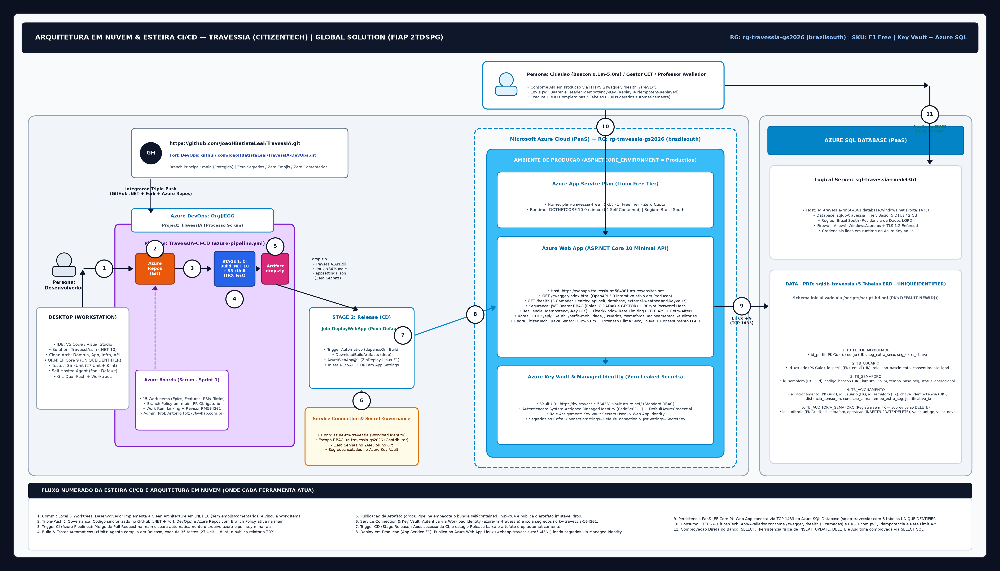

# TravessIA - Semaforo Inteligente e Mobilidade Urbana Inclusiva (CitizenTech GS 2026/2)

## 1. Visao Geral da Solucao e Impacto CitizenTech

O **TravessIA** e uma plataforma CitizenTech de mobilidade urbana inclusiva e seguranca viaria preditiva projetada para proteger cidadaos com mobilidade reduzida, idosos, cadeirantes e pessoas com deficiencia visual em travessias de pedestres.

Nos grandes centros urbanos, o tempo de fase verde para pedestres nos semaforos tradicionais e calculado com base na velocidade media de deslocamento de um adulto sem restricoes fisicas (1,2 m/s) sob condicoes climaticas ideais. Quando ocorrem chuvas moderadas ou tempestades, ou quando um idoso ou pessoa com deficiencia realiza a travessia em avenidas largas, esse tempo fixo torna-se insuficiente, elevando o risco de atropelamentos e quedas.

O **TravessIA** integra sensores fisicos de proximidade na calcada (Beacons BLE/IoT), perfis de mobilidade do cidadao (mediante consentimento expresso da LGPD) e telemetria meteorologica regional em tempo real (`SECO`, `CHUVA_MODERADA`, `TEMPESTADE`) para calcular dinamicamente e conceder segundos extras de travessia segura, registrando justificativas estruturadas de Inteligencia Artificial e trilha completa de auditoria para os gestores municipais de transito.

### Alinhamento aos Objetivos de Desenvolvimento Sustentavel da ONU (ODS)
- **ODS 3 (Saude e Bem-Estar - Meta 3.6)**: Reducao de acidentes de transito, quedas em pista molhada e atropelamentos de pedestres vulneraveis nas travessias urbanas.
- **ODS 9 (Industria, Inovacao e Infraestrutura - Meta 9.1)**: Modernizacao da infraestrutura viaria publica com sensores IoT, APIs resilientes em nuvem e automacao DevSecOps.
- **ODS 10 (Reducao das Desigualdades - Meta 10.2)**: Inclusao social e autonomia de locomocao urbana para idosos, cadeirantes e pessoas com deficiencia visual ou mobilidade reduzida.
- **ODS 11 (Cidades e Comunidades Sustentaveis - Meta 11.2)**: Sistemas de transporte e travessia seguros, acessiveis e sustentaveis com foco em grupos em situacao de vulnerabilidade.
- **ODS 13 (Acao Contra a Mudanca Global do Clima - Meta 13.1)**: Adaptacao ativa da infraestrutura semaforica a eventos climaticos extremos, chuvas intensas e alagamentos urbanos.

---

## 2. Integrantes do Grupo (2TDSPG - FIAP)

| Nome Completo | RM | Turma |
|---|---|---|
| Joao Henrique Batista Leal | RM564361 | 2TDSPG |
| Erik Naoki Miyasato | RM565771 | 2TDSPG |
| Juliana da Silva Stigliani | RM561171 | 2TDSPG |
| Gutemberg Rocha Silva | RM562267 | 2TDSPG |
| Gustavo Arthur Carvalho Sartori | RM561650 | 2TDSPG |

---

## 3. Arquitetura Macro da Solucao (Cloud Azure, Key Vault e CI/CD)



### Componentes de Infraestrutura Provisionados na Nuvem (Azure)
- **Assinatura Azure**: `Azure for Students - FIAP 2TDSPG (RM564361)`
- **Resource Group**: `rg-travessia-gs2026` (`brazilsouth`)
- **App Service Plan**: `plan-travessia-free` (`F1` Free Tier, Linux)
- **Azure Web App**: `webapp-travessia-rm564361` (`https://webapp-travessia-rm564361.azurewebsites.net`) com **System-Assigned Managed Identity**
- **Azure Key Vault**: `kv-travessia-564361` (`https://kv-travessia-564361.vault.azure.net/`) armazenando os segredos `ConnectionStrings--DefaultConnection` e `JwtSettings--SecretKey` lidos em tempo de execucao via `DefaultAzureCredential`
- **Azure SQL Server & Database**: `sql-travessia-rm564361.database.windows.net` / `sqldb-travessia` populado via `/scripts/script-bd.sql`
- **Azure DevOps Organization & Project**: `https://dev.azure.com/OrgJJEGG/TravessIA` (Processo `Scrum`, Azure Boards `Sprint 1`, Pipeline `TravessIA-CI-CD` via `/azure-pipeline.yml`)
- **URLs Publicas em Producao**:
  - **Swagger UI (Producao)**: `https://webapp-travessia-rm564361.azurewebsites.net/swagger`
  - **OpenAPI JSON**: `https://webapp-travessia-rm564361.azurewebsites.net/swagger/v1/swagger.json`
  - **Health Check (`/health`)**: `https://webapp-travessia-rm564361.azurewebsites.net/health`

---

## 4. Modelagem Relacional de Dados (5 Tabelas ERD e `/scripts/script-bd.sql`)

O banco de dados relacional implementa fielmente as 5 tabelas do diagrama entidade-relacionamento no script `/scripts/script-bd.sql` e no mapeamento Fluent API do Entity Framework Core (`TravessIA.Infrastructure`):

1. **`TB_PERFIL_MOBILIDADE`**: Cadastro de perfis de mobilidade (`id_perfil` PK `UNIQUEIDENTIFIER` / `Guid`, `codigo` UK, `descricao`, `seg_extra_seco`, `seg_extra_chuva`) com carga inicial deterministica para `PADRAO` (`11111111-1111-1111-1111-111111111101`), `IDOSO` (`11111111-1111-1111-1111-111111111102`), `CADEIRANTE` (`11111111-1111-1111-1111-111111111103`), `DEFICIENCIA_VISUAL` (`11111111-1111-1111-1111-111111111104`) e `MOBILIDADE_REDUZIDA` (`11111111-1111-1111-1111-111111111105`).
2. **`TB_USUARIO`**: Cadastro de cidadaos e gestores (`id_usuario` PK `UNIQUEIDENTIFIER` / `Guid`, `id_perfil` FK `UNIQUEIDENTIFIER` / `Guid`, `nome`, `email` UK, `senha_hash` BCrypt, `role` `CIDADAO`/`GESTOR`, `ano_nascimento`, `consentimento_lgpd` `'S'`/`'N'`, `dt_cadastro`).
3. **`TB_SEMAFORO`**: Cadastro de cruzamentos semaforicos monitorados por beacons (`id_semaforo` PK `UNIQUEIDENTIFIER` / `Guid`, `codigo_beacon` UK, `endereco`, `latitude`, `longitude`, `largura_via_m`, `tempo_base_seg`, `status_operacional` `ATIVO`/`MANUTENCAO`/`MODO_CHUVA`) com carga inicial deterministica para `BEACON-SP-001` (`22222222-2222-2222-2222-222222222201`), `BEACON-SP-002` (`22222222-2222-2222-2222-222222222202`) e `BEACON-SP-003` (`22222222-2222-2222-2222-222222222203`).
4. **`TB_ACIONAMENTO`**: Registro de acionamentos de travessia inteligente (`id_acionamento` PK `UNIQUEIDENTIFIER` / `Guid`, `id_usuario` FK `UNIQUEIDENTIFIER` / `Guid`, `id_semaforo` FK `UNIQUEIDENTIFIER` / `Guid`, `chave_idempotencia` UK, `dt_hora`, `distancia_sensor_m`, `condicao_clima` `SECO`/`CHUVA_MODERADA`/`TEMPESTADE`, `intensidade_chuva_mm`, `tempo_extra_seg`, `justificativa_ia`).
5. **`TB_AUDITORIA_SEMAFORO`**: Tabela de auditoria automatica sem restricao de chave estrangeira (`registra (sem FK)`) para preservar o historico mesmo apos delecao de semaforos (`id_auditoria` PK `UNIQUEIDENTIFIER` / `Guid`, `id_semaforo` `UNIQUEIDENTIFIER` / `Guid`, `operacao` `INSERT`/`UPDATE`/`DELETE`, `campo_alterado`, `valor_antigo`, `valor_novo`, `usuario_bd`, `dt_operacao`).

---

## 5. Requisitos Tecnicos .NET 10 e DevSecOps Implementados

1. **ASP.NET Core Minimal APIs + EF Core**:
   - Grupos de rotas versionados em `/api/v1/auth`, `/api/v1/perfis-mobilidade`, `/api/v1/usuarios`, `/api/v1/semaforos`, `/api/v1/acionamentos` e `/api/v1/auditorias`.
   - Regras de negocio de travessia inteligente (`POST /api/v1/acionamentos`): validacao de consentimento LGPD (`consentimento_lgpd == 'S'`), trava fisica de proximidade do sensor (`0.1m <= distancia_sensor_m <= 5.0m`), calculo adaptativo seco vs. chuva (`seg_extra_seco` vs. `seg_extra_chuva`), fator de largura da via (`largura_via_m`), bonus de seguranca para tempestade e geracao da explicacao em `justificativa_ia`.
2. **Documentacao OpenAPI / Swagger Fluente**:
   - Todos os endpoints sao documentados via metodos de extensao fluentes (`.WithName()`, `.WithTags()`, `.WithSummary()`, `.WithDescription()`, `.Accepts<T>()`, `.Produces<T>()`, `.ProducesProblem()`) e atributos `[Description]` nos DTOs, com suporte a autenticacao Bearer JWT na interface do Swagger em `Development` e `Production`.
3. **Autenticacao JWT e Autorizacao por Roles (`CIDADAO` e `GESTOR`)**:
   - Emissao de tokens JWT assinados com HMAC-SHA256 em `/api/v1/auth/login` e `/api/v1/auth/register`, protegendo operacoes administrativas com a politica `GestorOnly` (`GESTOR`) e operacoes de travessia com `CidadaoOrGestor`.
4. **Idempotencia (`Idempotency-Key`)**:
   - O endpoint `POST /api/v1/acionamentos` exige o cabecalho `Idempotency-Key` (ou `chaveIdempotencia`). Requisicoes repetidas com a mesma chave retornam o registro original com `HTTP 200 OK` e cabecalho `X-Idempotent-Replayed: true`, evitando acionamentos duplicados quando o pedestre pressiona o botao repetidamente.
5. **Rate Limiting com HTTP 429 (`ProblemDetails`)**:
   - Middleware `FixedWindowLimiter` configurado para retornar `HTTP 429 Too Many Requests` no padrao RFC 7807 `ProblemDetails` com cabecalho `Retry-After` quando a cota de requisicoes por janela e excedida.
6. **Health Checks (`/health`)**:
   - Endpoint `/health` monitorando as 3 dimensoes exigidas: `"api-self"` (disponibilidade do runtime da Minimal API), `"database"` (conectividade com o banco de dados via `TravessIAContext`) e `"external-weather-and-keyvault"` (motor de calculo meteorologico/IA e configuracao do provedor Azure Key Vault).
7. **Suite de Testes Unitarios e de Integracao (`xUnit.net`)**:
   - Projeto `TravessIA.Tests` com 35 testes automatizados (`27` testes unitarios de dominio + `8` testes de integracao com `WebApplicationFactory<Program>`), validando calculo seco vs. molhado, trava de distancia 0.1m-5.0m, consentimento LGPD, CRUD completo, auditoria automatica, JWT `401`/`403`, replay de idempotencia, Rate Limiting `429` e `/health`.

---

## 6. Exemplos Completos de Payloads JSON para Testes CRUD

### 6.1. Autenticacao (`POST /api/v1/auth/register` e `POST /api/v1/auth/login`)

#### Request (`POST /api/v1/auth/login`)
```json
{
  "email": "gestor@travessia.com.br",
  "senha": "Admin@TravessIA2026"
}
```

#### Response (`200 OK`)
```json
{
  "accessToken": "eyJhbGciOiJIUzI1NiIsInR5cCI6IkpXVCJ9...",
  "expiresAtUtc": "2026-11-11T20:56:41Z",
  "idUsuario": "33333333-3333-3333-3333-333333333303",
  "nome": "Gestor Mobilidade Urbana",
  "email": "gestor@travessia.com.br",
  "role": "GESTOR",
  "idPerfil": "11111111-1111-1111-1111-111111111101"
}
```

---

### 6.2. CRUD Tabela 1: `TB_SEMAFORO` (`/api/v1/semaforos`)

#### 1) Criar Semaforo - `POST /api/v1/semaforos` (Requer Bearer Token `GESTOR`)
**Request Body:**
```json
{
  "codigoBeacon": "BEACON-IBIRAPUERA-500",
  "endereco": "Av. Pedro Alvares Cabral, 500 - Vila Mariana, Sao Paulo - SP",
  "latitude": -23.5874162,
  "longitude": -46.6576338,
  "larguraViaM": 16.50,
  "tempoBaseSeg": 20,
  "statusOperacional": "ATIVO"
}
```

**Response (`201 Created`):**
```json
{
  "idSemaforo": "22222222-2222-2222-2222-222222222204",
  "codigoBeacon": "BEACON-IBIRAPUERA-500",
  "endereco": "Av. Pedro Alvares Cabral, 500 - Vila Mariana, Sao Paulo - SP",
  "latitude": -23.5874162,
  "longitude": -46.6576338,
  "larguraViaM": 16.50,
  "tempoBaseSeg": 20,
  "statusOperacional": "ATIVO"
}
```

#### 2) Listar Semaforos - `GET /api/v1/semaforos`
**Response (`200 OK`):**
```json
[
  {
    "idSemaforo": "22222222-2222-2222-2222-222222222201",
    "codigoBeacon": "BEACON-SP-001",
    "endereco": "Av. Paulista, 1106 - Bela Vista, Sao Paulo - SP",
    "latitude": -23.5641095,
    "longitude": -46.6524099,
    "larguraViaM": 18.50,
    "tempoBaseSeg": 15,
    "statusOperacional": "ATIVO"
  },
  {
    "idSemaforo": "22222222-2222-2222-2222-222222222204",
    "codigoBeacon": "BEACON-IBIRAPUERA-500",
    "endereco": "Av. Pedro Alvares Cabral, 500 - Vila Mariana, Sao Paulo - SP",
    "latitude": -23.5874162,
    "longitude": -46.6576338,
    "larguraViaM": 16.50,
    "tempoBaseSeg": 20,
    "statusOperacional": "ATIVO"
  }
]
```

#### 3) Atualizar Semaforo - `PUT /api/v1/semaforos/22222222-2222-2222-2222-222222222204` (Requer Bearer Token `GESTOR`)
**Request Body:**
```json
{
  "codigoBeacon": "BEACON-IBIRAPUERA-500",
  "endereco": "Av. Pedro Alvares Cabral, 500 - Portao 3 Ibirapuera, Sao Paulo - SP",
  "latitude": -23.5874162,
  "longitude": -46.6576338,
  "larguraViaM": 16.50,
  "tempoBaseSeg": 24,
  "statusOperacional": "MODO_CHUVA"
}
```

**Response (`200 OK`):**
```json
{
  "idSemaforo": "22222222-2222-2222-2222-222222222204",
  "codigoBeacon": "BEACON-IBIRAPUERA-500",
  "endereco": "Av. Pedro Alvares Cabral, 500 - Portao 3 Ibirapuera, Sao Paulo - SP",
  "latitude": -23.5874162,
  "longitude": -46.6576338,
  "larguraViaM": 16.50,
  "tempoBaseSeg": 24,
  "statusOperacional": "MODO_CHUVA"
}
```

#### 4) Remover Semaforo - `DELETE /api/v1/semaforos/22222222-2222-2222-2222-222222222204` (Requer Bearer Token `GESTOR`)
**Response:** `204 No Content` (Gera registro automatico de auditoria `DELETE` em `TB_AUDITORIA_SEMAFORO`).

---

### 6.3. CRUD Tabela 2: `TB_PERFIL_MOBILIDADE` (`/api/v1/perfis-mobilidade`)

#### 1) Criar Perfil de Mobilidade - `POST /api/v1/perfis-mobilidade` (Requer Bearer Token `GESTOR`)
**Request Body:**
```json
{
  "codigo": "GESTANTE_INFANTIL",
  "descricao": "Gestantes e responsaveis com carrinho de bebe",
  "segExtraSeco": 7,
  "segExtraChuva": 13
}
```

**Response (`201 Created`):**
```json
{
  "idPerfil": "11111111-1111-1111-1111-111111111106",
  "codigo": "GESTANTE_INFANTIL",
  "descricao": "Gestantes e responsaveis com carrinho de bebe",
  "segExtraSeco": 7,
  "segExtraChuva": 13
}
```

#### 2) Consultar Perfil por ID - `GET /api/v1/perfis-mobilidade/11111111-1111-1111-1111-111111111106`
**Response (`200 OK`):**
```json
{
  "idPerfil": "11111111-1111-1111-1111-111111111106",
  "codigo": "GESTANTE_INFANTIL",
  "descricao": "Gestantes e responsaveis com carrinho de bebe",
  "segExtraSeco": 7,
  "segExtraChuva": 13
}
```

#### 3) Atualizar Perfil de Mobilidade - `PUT /api/v1/perfis-mobilidade/11111111-1111-1111-1111-111111111106` (Requer Bearer Token `GESTOR`)
**Request Body:**
```json
{
  "codigo": "GESTANTE_INFANTIL",
  "descricao": "Gestantes, lactantes e responsaveis com bebe de colo",
  "segExtraSeco": 8,
  "segExtraChuva": 15
}
```

**Response (`200 OK`):**
```json
{
  "idPerfil": "11111111-1111-1111-1111-111111111106",
  "codigo": "GESTANTE_INFANTIL",
  "descricao": "Gestantes, lactantes e responsaveis com bebe de colo",
  "segExtraSeco": 8,
  "segExtraChuva": 15
}
```

#### 4) Remover Perfil de Mobilidade - `DELETE /api/v1/perfis-mobilidade/11111111-1111-1111-1111-111111111106` (Requer Bearer Token `GESTOR`)
**Response:** `204 No Content`

---

### 6.4. CRUD Tabela 3: `TB_ACIONAMENTO` (`/api/v1/acionamentos`) com `Idempotency-Key`

#### 1) Solicitar Travessia Inteligente - `POST /api/v1/acionamentos` (Requer Bearer Token `CIDADAO` ou `GESTOR`)
**Headers:**
- `Authorization: Bearer <token>` (o `id_usuario` e extraido automaticamente das claims do token JWT)
- `Idempotency-Key: cloud-prod-travessia-2026-001` (opcional no Swagger UI; quando enviado, garante idempotencia `X-Idempotent-Replayed: true`)

**Request Body:**
```json
{
  "codigoBeacon": "BEACON-SP-001",
  "distanciaSensorM": 3.50,
  "condicaoClima": "CHUVA_MODERADA",
  "intensidadeChuvaMm": 12.50
}
```

**Response (`201 Created` na 1a chamada com `X-Idempotent-Replayed: false` / `200 OK` com `X-Idempotent-Replayed: true` em chamadas subsequentes):**
```json
{
  "idAcionamento": "44444444-4444-4444-4444-444444444401",
  "idUsuario": "33333333-3333-3333-3333-333333333302",
  "idSemaforo": "22222222-2222-2222-2222-222222222201",
  "chaveIdempotencia": "cloud-prod-travessia-2026-001",
  "dtHora": "2026-11-11T18:58:17.0514376Z",
  "distanciaSensorM": 1.80,
  "condicaoClima": "CHUVA_MODERADA",
  "intensidadeChuvaMm": 14.50,
  "tempoExtraSeg": 22,
  "tempoBaseSeg": 16,
  "tempoTotalSeg": 38,
  "justificativaIa": "TravessIA Decision Engine: Perfil=IDOSO (+12s) | Clima=CHUVA_MODERADA (14.50mm) | LarguraVia=18.50m (+10s) | BonusTempestade=+0s | TempoBase=16s | TempoExtraConcedido=22s | TempoTotalTravessia=38s."
}
```

#### 2) Listar Acionamentos - `GET /api/v1/acionamentos` (Requer Bearer Token)
**Response (`200 OK`):**
```json
[
  {
    "idAcionamento": "44444444-4444-4444-4444-444444444401",
    "idUsuario": "33333333-3333-3333-3333-333333333302",
    "idSemaforo": "22222222-2222-2222-2222-222222222201",
    "chaveIdempotencia": "cloud-prod-travessia-2026-001",
    "dtHora": "2026-11-11T18:58:17.0514376Z",
    "distanciaSensorM": 1.80,
    "condicaoClima": "CHUVA_MODERADA",
    "intensidadeChuvaMm": 14.50,
    "tempoExtraSeg": 22,
    "tempoBaseSeg": 16,
    "tempoTotalSeg": 38,
    "justificativaIa": "TravessIA Decision Engine: Perfil=IDOSO (+12s) | Clima=CHUVA_MODERADA (14.50mm) | LarguraVia=18.50m (+10s) | BonusTempestade=+0s | TempoBase=16s | TempoExtraConcedido=22s | TempoTotalTravessia=38s."
  }
]
```

#### 3) Consultar Acionamento por ID - `GET /api/v1/acionamentos/44444444-4444-4444-4444-444444444401` (Requer Bearer Token)
**Response (`200 OK`):**
```json
{
  "idAcionamento": "44444444-4444-4444-4444-444444444401",
  "idUsuario": "33333333-3333-3333-3333-333333333302",
  "idSemaforo": "22222222-2222-2222-2222-222222222201",
  "chaveIdempotencia": "cloud-prod-travessia-2026-001",
  "dtHora": "2026-11-11T18:58:17.0514376Z",
  "distanciaSensorM": 1.80,
  "condicaoClima": "CHUVA_MODERADA",
  "intensidadeChuvaMm": 14.50,
  "tempoExtraSeg": 22,
  "tempoBaseSeg": 16,
  "tempoTotalSeg": 38,
  "justificativaIa": "TravessIA Decision Engine: Perfil=IDOSO (+12s) | Clima=CHUVA_MODERADA (14.50mm) | LarguraVia=18.50m (+10s) | BonusTempestade=+0s | TempoBase=16s | TempoExtraConcedido=22s | TempoTotalTravessia=38s."
}
```

#### 4) Remover Acionamento - `DELETE /api/v1/acionamentos/44444444-4444-4444-4444-444444444401` (Requer Bearer Token `GESTOR`)
**Response:** `204 No Content`

---

### 6.5. Consulta Tabela 5: `TB_AUDITORIA_SEMAFORO` (`/api/v1/auditorias`)

#### Listar Registros de Auditoria - `GET /api/v1/auditorias` (Requer Bearer Token `GESTOR`)
**Response (`200 OK`):**
```json
[
  {
    "idAuditoria": "55555555-5555-5555-5555-555555555501",
    "idSemaforo": "22222222-2222-2222-2222-222222222201",
    "operacao": "UPDATE",
    "campoAlterado": "tempo_base_seg",
    "valorAntigo": "15",
    "valorNovo": "16",
    "usuarioBd": "gestor@travessia.sp.gov.br",
    "dtOperacao": "2026-11-11T18:58:16.8976937Z"
  }
]
```

---

### 6.6. CRUD Tabela 4: `TB_USUARIO` (`/api/v1/usuarios`)

#### 1) Cadastrar Cidadao - `POST /api/v1/auth/register`
**Request Body (sem necessidade de informar GUID; `id_perfil` resolvido automaticamente por `codigoPerfil` ou idade >= 60 anos):**
```json
{
  "nome": "Maria Aparecida",
  "email": "maria.cidada@travessia.com.br",
  "senha": "TravessIA@2026",
  "role": "CIDADAO",
  "anoNascimento": 1952,
  "codigoPerfil": "IDOSO",
  "consentimentoLgpd": "S"
}
```

**Response (`201 Created`):**
```json
{
  "accessToken": "eyJhbGciOiJIUzI1NiIsInR5cCI6IkpXVCJ9...",
  "expiresAtUtc": "2026-11-11T21:30:00Z",
  "idUsuario": "33333333-3333-3333-3333-333333333304",
  "nome": "Maria Aparecida",
  "email": "maria.cidada@travessia.com.br",
  "role": "CIDADAO",
  "idPerfil": "11111111-1111-1111-1111-111111111102"
}
```

#### 2) Consultar Usuario por ID - `GET /api/v1/usuarios/33333333-3333-3333-3333-333333333304` (Requer Bearer Token)
**Response (`200 OK` - sem exposicao de `senha_hash`):**
```json
{
  "idUsuario": "33333333-3333-3333-3333-333333333304",
  "idPerfil": "11111111-1111-1111-1111-111111111102",
  "codigoPerfil": "IDOSO",
  "nome": "Maria Aparecida",
  "email": "maria.cidada@travessia.com.br",
  "role": "CIDADAO",
  "anoNascimento": 1952,
  "consentimentoLgpd": "S",
  "dtCadastro": "2026-11-11T19:30:00Z"
}
```

#### 3) Atualizar Usuario - `PUT /api/v1/usuarios/33333333-3333-3333-3333-333333333304` (Requer Bearer Token)
**Request Body:**
```json
{
  "nome": "Maria Aparecida Cadeirante",
  "email": "maria.cidada@travessia.com.br",
  "role": "CIDADAO",
  "anoNascimento": 1952,
  "codigoPerfil": "CADEIRANTE",
  "consentimentoLgpd": "S"
}
```

**Response (`200 OK`):**
```json
{
  "idUsuario": "33333333-3333-3333-3333-333333333304",
  "idPerfil": "11111111-1111-1111-1111-111111111103",
  "codigoPerfil": "CADEIRANTE",
  "nome": "Maria Aparecida Cadeirante",
  "email": "maria.cidada@travessia.com.br",
  "role": "CIDADAO",
  "anoNascimento": 1952,
  "consentimentoLgpd": "S",
  "dtCadastro": "2026-11-11T19:30:00Z"
}
```

#### 4) Remover Usuario - `DELETE /api/v1/usuarios/33333333-3333-3333-3333-333333333304` (Requer Bearer Token `GESTOR`)
**Response:** `204 No Content`

---

### 6.7. Monitoramento de Saude (`GET /health`)

#### Consultar Saude da API, Banco de Dados e Servicos Externos - `GET /health`
**Response (`200 OK`):**
```json
{
  "status": "Healthy",
  "service": "TravessIA.API",
  "duration": "00:00:00.0036382",
  "checks": [
    {
      "name": "api-self",
      "status": "Healthy",
      "description": "TravessIA Minimal API runtime operacional e responsivo.",
      "duration": "00:00:00.0000057",
      "error": null
    },
    {
      "name": "database",
      "status": "Healthy",
      "description": null,
      "duration": "00:00:00.0033253",
      "error": null
    },
    {
      "name": "external-weather-and-keyvault",
      "status": "Healthy",
      "description": "Motor de telemetria climatica/IA operacional e Azure Key Vault conectado (https://kv-travessia-564361.vault.azure.net/).",
      "duration": "00:00:00.0000278",
      "error": null
    }
  ]
}
```

---

## 7. Como Executar Localmente e no Docker

### Pre-requisitos
- .NET SDK 10.0 (`10.0.100` ou superior)
- Docker Desktop (opcional, para execucao conteinerizada)

### Passos para Execucao Local
1. Clone o repositorio e acesse a pasta raiz:
   ```bash
   git clone https://github.com/JoaoHBatistaLeal/TravessIA.git
   cd TravessIA
   ```
2. Restaure os pacotes e compile a solucao:
   ```bash
   dotnet restore TravessIA.sln
   dotnet build TravessIA.sln --configuration Release
   ```
3. Execute a suite completa de testes automatizados (Unitarios + Integracao `xUnit`):
   ```bash
   dotnet test TravessIA.sln --configuration Release
   ```
4. Inicie a API:
   ```bash
   dotnet run --project TravessIA.API/TravessIA.API.csproj
   ```
5. Acesse o Swagger UI em `http://localhost:5000/swagger` e o Health Check em `http://localhost:5000/health`.

### Execucao via Docker (`/dockerfiles/Dockerfile`)
```bash
docker build -f dockerfiles/Dockerfile -t travessia-api:latest .
docker run -d -p 8080:8080 -e ASPNETCORE_ENVIRONMENT=Production travessia-api:latest
```

---

## 8. Declaracao Obrigatoria de Uso de Inteligencia Artificial Generativa

Em conformidade com as diretrizes academicas da FIAP para a Global Solution 2026/2, declaramos que ferramentas de Inteligencia Artificial Generativa foram utilizadas como assistentes de apoio durante o desenvolvimento deste projeto nas seguintes frentes:
1. **Revisao e Estruturacao de Codigo**: Apoio na refatoracao de camadas Clean Architecture (`Domain`, `Application`, `Infrastructure`, `API`), mapeamento Fluent API do Entity Framework Core e padronizacao de descricoes OpenAPI/Swagger.
2. **Automacao de Testes e Infraestrutura como Codigo (IaC)**: Auxilio na elaboracao de cenarios de teste `xUnit` (`WebApplicationFactory<Program>`) e scripts de provisionamento Azure CLI (`scripts/provision-azure.sh`) e pipeline YAML (`azure-pipeline.yml`).
3. **Supervisao e Validacao Humana**: Todas as regras de negocio de travessia inteligente, modelagem relacional das 5 tabelas (`script-bd.sql`), configuracoes de seguranca com Azure Key Vault (`DefaultAzureCredential`) e validacoes em nuvem foram integralmente revisadas, testadas e auditadas pelos integrantes do grupo, que assumem total responsabilidade tecnica e autoral pela solucao entregue.
